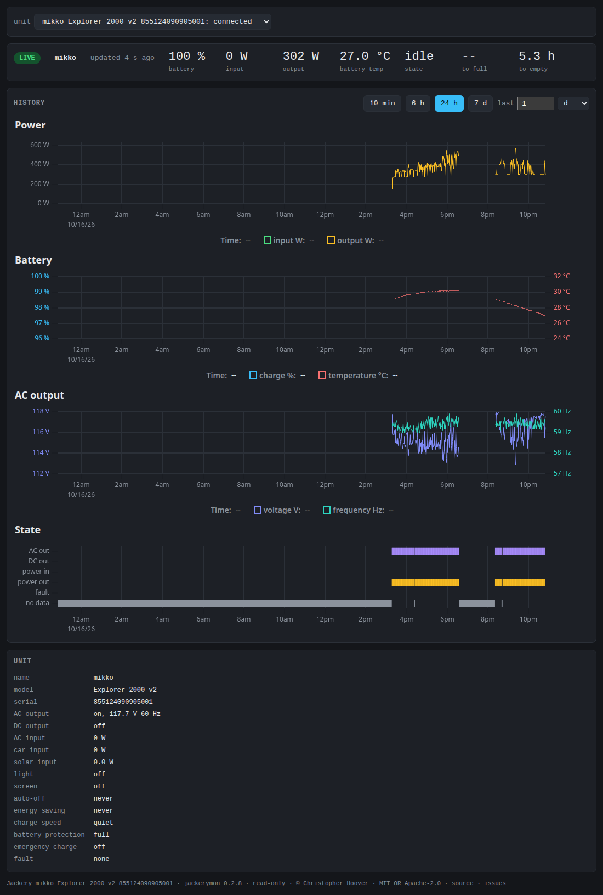

# jackerymon

Monitor and control Jackery Explorer and HomePower power stations over
Bluetooth LE, one or several at once, without Jackery's cloud.  Linux
only.  Background: [PLAN.md](PLAN.md),
[FINDINGS.md](FINDINGS.md), [docs/protocol.md](docs/protocol.md).



```sh
cargo build --release      # builds target/release/jackerymon
cargo test
```

## Hardware

Tested: three Explorer 2000 v2s (app model code 12), an Explorer 3000
(14) and a HomePower 3000 (19), the last two without a light, all
advertising as `HT`, polled at once by one daemon, from a
laptop with an Intel Bluetooth controller, Ubuntu 25.04, Linux 6.14,
and BlueZ 5.79.

Other units:

- Other Explorers that advertise as `HT`: probably the same protocol,
  but some add an IV to the cipher.  jackerymon refuses models other
  than 12, 14 and 19 until one is tested; reports welcome on the
  [issues page](https://github.com/charlieh0tel/jackerymon/issues).
- Explorer 2000 Ultra (`HL`): a different protocol; will not work.
- SolarVault (models 3001-3004): AES instead of RC4, and likely other
  status keys; support awaits a unit to test.

## Wi-Fi and Bluetooth

The unit turns its radios off if nothing connects within five minutes of
power-on.  To turn them on or off, hold DC/USB and AC together until the
Wi-Fi and Bluetooth icons light or go out.  Flashing icons mean the unit
is waiting for a connection.  Do not hold POWER and DC/USB: that resets
the radios and unbinds the unit from your account.  (From the Explorer
2000 Plus manual.)

## Key

Each unit has its own BLE key, which only Jackery's cloud hands out.
Fetch it once, in a terminal:

```sh
jackerymon scan            # units in range
jackerymon key             # prompts for your Jackery email and password
```

Add `--address` when several units are in range, and `--bind` if the
unit is not yet bound to your account.  The key goes to
`~/.config/jackerymon/<serial>.json`, readable only by you; the password
and session token are never saved.  From then on, everything uses BLE
alone.

Every command finds keys there, except `daemon`, which reads
`/etc/jackerymon/<serial>.json` and serves every unit with a key there.
With several keys, other commands take `--unit SERIAL`; `--key-file`
names a file directly.

Units can have names: a `names` file beside the keys, one `<serial>
<name>` per line, `#` for comments.  `--unit` then takes a name too,
and the web view, the TUI and the metrics (`jackery_unit_info`) show
it.

## Commands

```sh
jackerymon poll            # JSON line per sample until Ctrl-C; --count N
jackerymon tui             # live status screen; m opens settings
jackerymon set light low   # change one setting; see set --help
jackerymon daemon          # web view, metrics, status, settings over HTTP
```

`set` and the TUI report a change only once a status read shows it.
Turning emergency charging on needs `--yes`, or y in the TUI.

The unit takes one BLE connection, so one jackerymon holds it at a time
(a lock in `/run/lock`), and while one does the phone app cannot
connect.  If a daemon is running, `tui` and `set` find it and go
through it; `--direct` connects to the unit instead, and `--daemon`
names a daemon by socket or URL (`http://host:9888/units/<serial>`).

Commands other than `tui` log BLE recoveries to stderr; `RUST_LOG`
sets the filter.

## Daemon

`jackerymon daemon` holds the connection to each unit and serves each
unit's full API on its own Unix socket,
`$XDG_RUNTIME_DIR/jackerymon/<serial>.sock` (packaged:
`/run/jackerymon/`), and the read-only routes over TCP, each unit's
under `/units/<serial>`.  TCP's `/` is an overview of every unit: a
live table (state, charge, power, temperature, hours to full or empty,
and the total input and output), and charts of every unit's charge,
every unit's output and input stacked, each unit a band in its color,
and each one's power.  Each unit's page has a
chooser of units, connected ones first, each group by serial, and a
link back.  TCP's `/metrics` covers every unit, labeled `serial`;
`/units` lists them with their latest readings.

| Route, per unit | Gives | TCP |
|---|---|---|
| `GET /status` | model, link state, counters, latest sample | yes |
| `GET /metrics` | Prometheus `jackery_*` metrics | yes |
| `GET /events` | server-sent events: current state, then changes | yes |
| `GET /history?since=…&until=…` | logged samples, JSON lines; needs `--log-dir` | yes |
| `GET /series?since=…&every=…` | chart columns, averaged per interval; needs `--log-dir` | yes |
| `GET /` | the web view: live status; power and battery charts (input by source), AC output voltage and frequency while it was on, and a strip of states (outputs on, power in and out, faults, no data); the unit's settings (read-only) | yes |
| `POST /settings` | one setting, e.g. `{"lm":1}`; answers once applied | only with `--tcp-control` |

```sh
curl -s --unix-socket $XDG_RUNTIME_DIR/jackerymon/<serial>.sock \
    -X POST -H 'content-type: application/json' -d '{"oac":1}' \
    http://localhost/settings
```

For Prometheus, and Grafana on top of it, scrape `/metrics`, one
target for every unit; set `JACKERYMON_LISTEN` (below) if Prometheus
runs elsewhere:

```yaml
scrape_configs:
  - job_name: jackery
    static_configs:
      - targets: ["host:9888"]
```

Metrics cover battery charge and temperature, input and output power
by source, the unit's time estimates, AC output, outputs on, fault
code, and the link (`jackery_connected`, counters, last sample time).
Readings older than 60 s are left out.

Setting keys and values are in `docs/protocol.md`; other options are in
`jackerymon daemon --help`. A custom `--socket` belongs in a directory
only its users can write. TCP has no authentication, so with
`--tcp-control` anyone who reaches it, including a web page through DNS
rebinding, can switch outputs.

## Install

Releases carry `.deb` packages for amd64 and arm64.  The package adds a
`jackerymon` user and group and a `jackerymon` service, installed
disabled.  To run the daemon:

```sh
sudo apt install ./jackerymon_*.deb
jackerymon key                       # if you have no key yet
sudo install -m 0640 -g jackerymon ~/.config/jackerymon/*.json /etc/jackerymon/
sudo install -m 0640 -g jackerymon ~/.config/jackerymon/names /etc/jackerymon/  # if any
sudo usermod -aG jackerymon $USER    # control through the socket; log in again
sudo systemctl enable --now jackerymon
```

Daemon options are in `/etc/default/jackerymon`.  Samples go to
`/var/lib/jackerymon/<serial>/`, one file per day; a daily timer gzips finished
days, and nothing is deleted.

To build the package: `cargo deb -p jackerymon-cli`; to release, see
[RELEASING.md](RELEASING.md).  `make screenshot` retakes the picture
above from a running daemon.

## License

Copyright © 2026 Christopher Hoover.  MIT OR Apache-2.0; see
`LICENSE-MIT` and `LICENSE-APACHE`.  Source:
<https://github.com/charlieh0tel/jackerymon>; issues:
<https://github.com/charlieh0tel/jackerymon/issues>.
